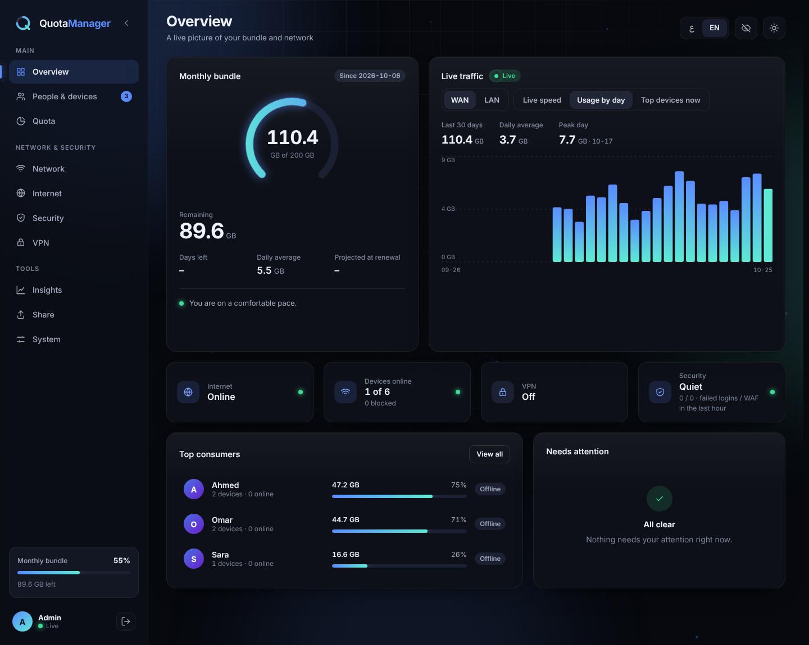
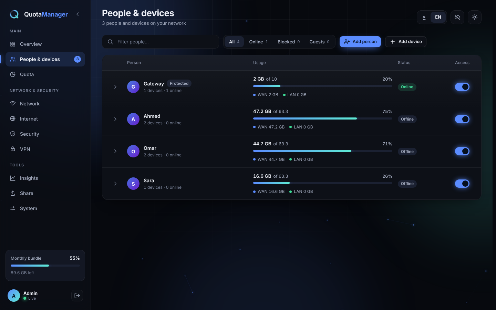
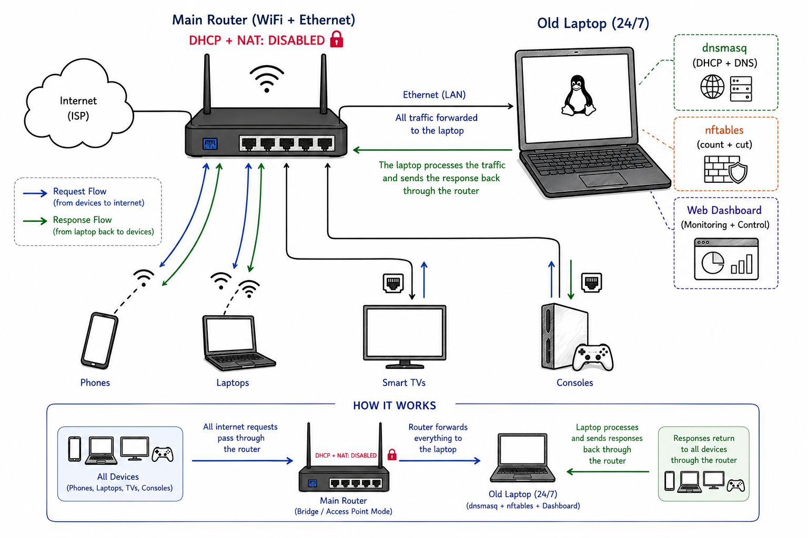

<p align="center">
  
</p>

<h1 align="center">Quota Manager</h1>

<p align="center">
  Share one limited internet bundle fairly between everyone at home.
</p>

<p align="center">
  <a href="README_AR.md"></a>
  
</p>

<p align="center">
  <br><br>
  
</p>

---

## What it does

Every person gets a monthly allowance (a fixed number of GB, or an equal share of what's left). All of their devices share it. When it runs out, **their devices are cut off** — nobody else is affected.

- See who used how much, live, per person and per device
- Set speed limits and keep gaming ping low while others download
- Block, kick or pause any device in one tap
- Block ads and adult/gambling sites for the whole house
- Built-in VPN, firewall, file sharing between devices, and remote access from anywhere (Tailscale)
- Works in **English and Arabic**, light and dark, on phone and desktop

## How it works

A small always-on computer sits between your router and your devices. Your router keeps WiFi; this computer hands out the addresses and counts the traffic.

<p align="center">
  
</p>

---

## Install

You need **one always-on device** connected to your router **by cable**. Pick yours:

| Your device | Best for | Go to |
|---|---|---|
| Old laptop / mini PC / desktop (Debian, Kali, Ubuntu) | Most people | [Linux PC](#linux-pc-or-laptop) |
| Raspberry Pi | Low power, silent | [Raspberry Pi](#raspberry-pi) |
| Windows or Mac you already use | No spare device | [Virtual machine](#windows--mac-virtual-machine) |
| Old rooted Android phone | 2–5 W, battery backup | [Android](#old-android-phone-rooted) |
| OpenWrt router | Advanced | [OpenWrt](#openwrt-router) |

> Wi-Fi can't be used for the gateway itself — it must be plugged in with a cable (a cheap USB-to-Ethernet adapter works). It must stay on 24/7: if it is off, nobody has internet.

### Linux PC or laptop

Works on **Debian, Kali and Ubuntu**. Run in a terminal:

```bash
sudo apt-get update
sudo install -d /etc/apt/keyrings
curl -fsSL https://UserJoo9.github.io/QuotaManager/quota-manager.gpg | \
  sudo gpg --dearmor -o /etc/apt/keyrings/quota-manager.gpg
echo "deb [signed-by=/etc/apt/keyrings/quota-manager.gpg] https://UserJoo9.github.io/QuotaManager stable main" | \
  sudo tee /etc/apt/sources.list.d/quota-manager.list
sudo apt-get update
sudo apt-get install quota-manager
```

Prefer a single file? Download `quota-manager_<version>_all.deb` from [Releases](https://github.com/UserJoo9/QuotaManager/releases) and run `sudo apt install ./quota-manager_*_all.deb`.

Then continue with [First setup](#first-setup).

### Raspberry Pi

1. Install **Raspberry Pi OS** (64-bit, Lite is fine) with Raspberry Pi Imager.
2. Plug it into the router with an Ethernet cable.
3. Follow the [Linux PC](#linux-pc-or-laptop) steps above, then [First setup](#first-setup).

### Windows / Mac (virtual machine)

No spare device? Run the gateway inside a Debian virtual machine on the computer you already have.

1. Install **VirtualBox** or **VMware**, and create a **Debian** VM.
2. Set the VM network to **Bridged** and pick the **Ethernet (cable)** adapter, not Wi-Fi.
3. Install the package inside the VM using the [Linux PC](#linux-pc-or-laptop) steps.
4. The computer must stay on, and wired, while you want the limits to work.

Great for trying Quota Manager before buying anything.

### Old Android phone (rooted)

Android 7–14 with root, plus a USB-C/OTG hub with an **Ethernet port and charging pass-through**.

1. Plug the hub into the router with a cable.
2. Install a Debian 12 (ARM64) chroot (for example with LinuxDeploy) and open its terminal as root.
3. Follow the [Linux PC](#linux-pc-or-laptop) steps inside it, then [First setup](#first-setup).

Tip: limit charging to 60–70 % (ACC app) so the battery lasts.

### OpenWrt router

OpenWrt 22.03+ with 128 MB+ RAM (on small-flash routers, use a USB drive with ExtRoot).

```bash
opkg update
opkg install python3 python3-pip nftables kmod-nft-core ip-full dnsmasq-full
git clone https://github.com/UserJoo9/QuotaManager.git /opt/QuotaManager
cd /opt/QuotaManager && pip install -r requirements-linux.txt
cp scripts/quota-manager.openwrt /etc/init.d/quota-manager
chmod +x /etc/init.d/quota-manager
/etc/init.d/quota-manager enable && /etc/init.d/quota-manager start
```

---

## First setup

**1. Turn off DHCP on your router.** Open your router's page (usually `http://192.168.1.1`), find *DHCP / LAN* and switch DHCP **off**. Keep **Wi-Fi** and **NAT** on. Also turn off **IPv6 / Router Advertisement** if you see it.

**2. Reconnect your devices** (toggle airplane mode or Wi-Fi) so they get a new address from the gateway.

**3. Open the dashboard** from any device:

```
http://192.168.2.1:8080
```

Password: **`admin`** — you'll be asked to change it right away.

**4. Fill in the welcome screen:** your bundle size (e.g. `140` GB) and the day your provider renews it.

**5. Give people allowances.** New devices appear on their own, but start **disabled** (0 GB) as a safety lock. Add a person, assign the device to them, and set their share.

> Can't open the dashboard? A device that still has an old address needs to reconnect. You can also try `http://192.168.1.110:8080`.
>
> Give the gateway a fixed address (reserve it on the router) — if its address changes, nobody gets internet.

---

## Reach the dashboard from outside your home

Many internet lines block or drop connections coming from outside, so opening a port on your public IP often does not work. Use the built-in **Tailscale** instead: **Internet → Remote access → Install**, sign in once, then install the Tailscale app on your phone with the same account and open the address shown on that card. Nothing is opened on your public IP, so keep the "Allow dashboard access from the internet" switch off.

---

## Using it

| Page | What you do there |
|---|---|
| **Overview** | Remaining bundle, days left, live speed and who is using it right now |
| **People & devices** | Add people, move devices, top up GB, speed limits, block or kick |
| **Quota** | Bundle size, renewal day, top-up packs |
| **Network** | Guest mode, new-device rules, IP reservations, allow / block lists |
| **Internet** | Line status, public IP, direct PPPoE mode, remote access with Tailscale |
| **Security** | Firewall, ad & content blocking, HTTPS |
| **VPN** | Add servers, choose who goes through the VPN |
| **Insights** | Daily usage, top devices, most visited domains |
| **Share** | Send files and folders between devices, even straight to a nearby device |
| **System** | Language, light/dark, colour themes, password and 2FA, updates, logs |

Handy to know:

- **Top up** a person mid-month from their card — they're back online instantly.
- **Eye icon** hides names and MAC addresses, handy before showing your screen.
- **My usage page:** any device can open `http://192.168.2.1:8080/milestone` (no login) to see its own remaining allowance.
- The dashboard opens at the same address as always (`http://<gateway>:8080/`). Old bookmarks to `/ui/` forward there automatically.
- **WAN | LAN switch** above the Overview chart: the same live speed, daily usage and top devices, for the internet or for traffic inside your home (NAS, router, the gateway itself).
- **Sharing**: drop files or folders on the Share page, or send them straight to another device on the WiFi (up to 50 MB; several files or folders arrive as one ZIP).
- Risky buttons (kick, blacklist, enable HTTPS, remove an allow/block entry, clear all) ask you to **tap twice** — the second tap confirms.

---

## Update & remove

The dashboard checks for updates itself (**System → Updates**) and can install them in one click. Your settings and data are kept.

```bash
sudo apt-get update && sudo apt-get install --only-upgrade quota-manager   # update
sudo apt remove quota-manager                                              # remove, keep data
sudo apt purge quota-manager                                               # remove everything
```

Your data lives in `/var/lib/quota-gateway/quota.db` — copy it now and then as a backup.

## Troubleshooting

| Problem | Fix |
|---|---|
| No internet after setup | Make sure router DHCP is **off**, then reconnect the device |
| Device has internet but isn't counted | Turn off IPv6 / Router Advertisement on the router |
| Install says "no installation candidate" | Run `sudo apt-get update` first |
| Everything stopped after a reboot | `sudo systemctl enable --now quota-gateway` |
| Forgot the password | Ask in an issue, or see the developer guide below |
| Speed limits do nothing | Network page → turn shaping on and enter your real line speed |

## Good to know

- Usage is counted every ~15 seconds, so numbers are approximate.
- Over-limit users are fully cut off, not slowed.
- If the gateway loses power, the home network loses internet.
- Deleting a device blocks it for good until you remove it from the block list.
- One admin session at a time: signing in on another device signs the first one out, and changing the password signs out everywhere.
- In **LAN** mode, firewall rules whose source is your home network have no effect (home devices are always allowed); use blocks or switch to **WAN** mode to restrict them.

---

**Developers:** see [Structure_README.md](Structure_README.md) · **License:** [MIT](LICENSE) · Not affiliated with any ISP.
