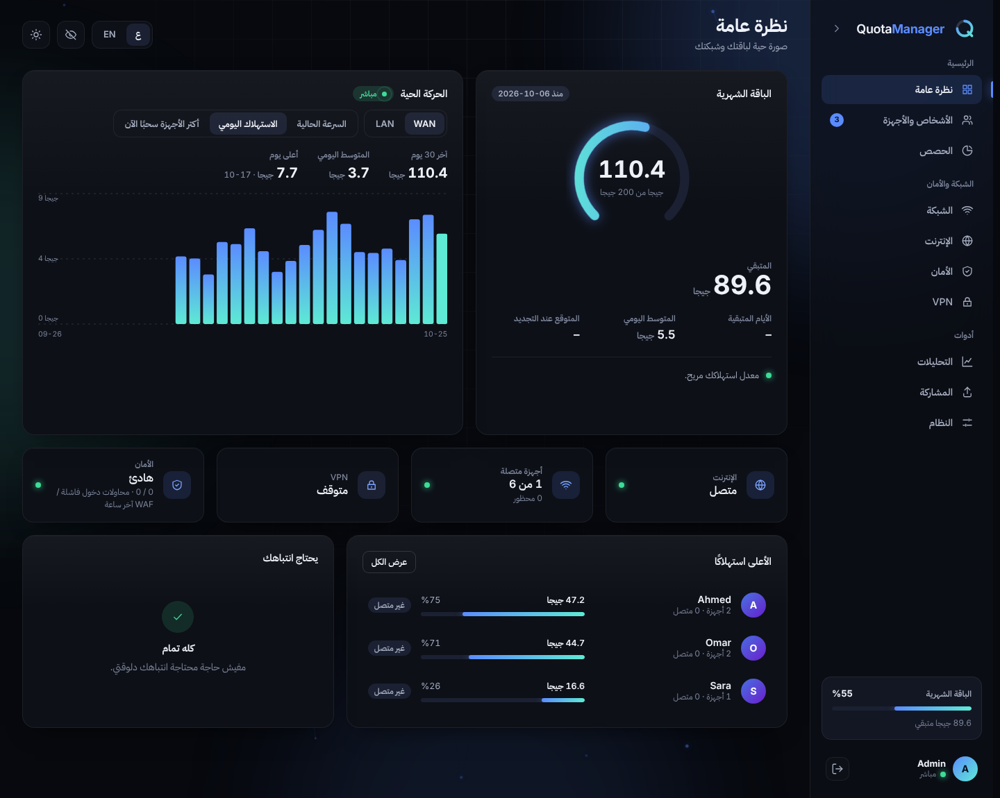
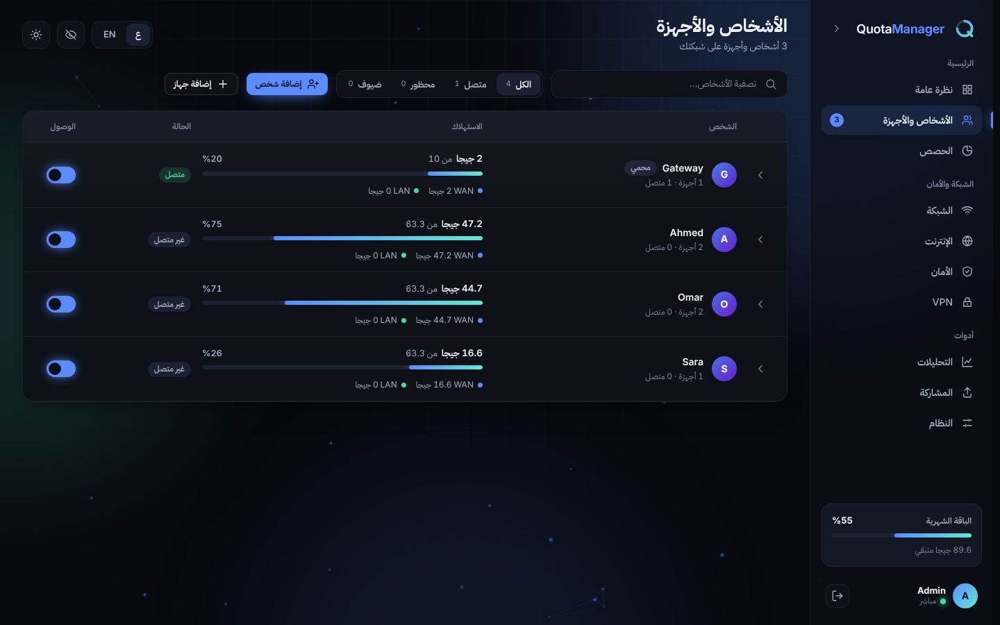
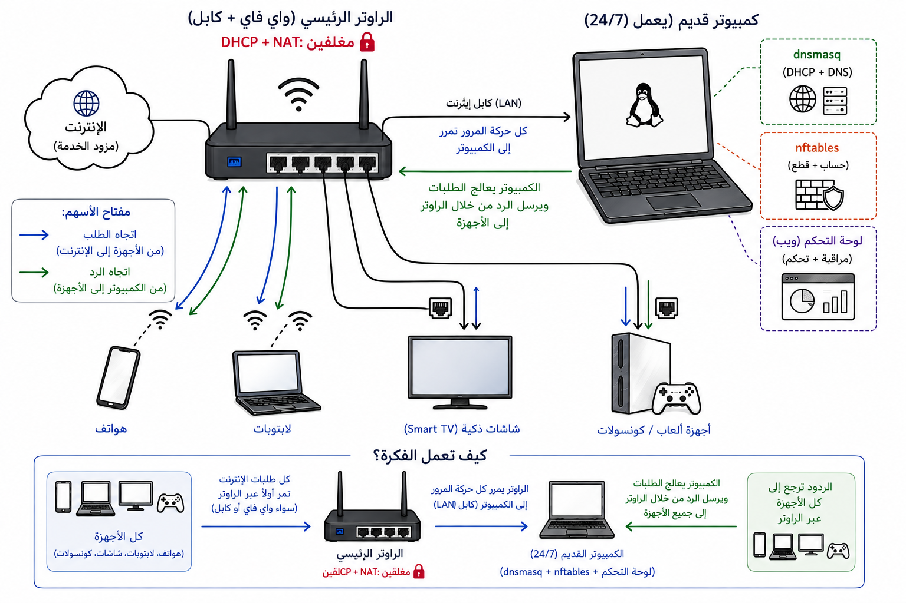

<p align="center">
  
</p>

<h1 align="center">Quota Manager</h1>

<p align="center">
  وزّع باقة الإنترنت المحدودة بعدل بين كل اللي في البيت.
</p>

<p align="center">
  <a href="README.md"></a>
  
</p>

<p align="center">
  <br><br>
  
</p>

<div dir="rtl">

---

## بيعمل إيه

كل شخص بياخد حصة شهرية (عدد جيجابايت ثابت، أو نصيب متساوي من المتبقي)، وكل أجهزته بتتشارك فيها. لما الحصة تخلص **أجهزته هو بس بتتفصل** — وباقي البيت مش بيتأثر.

- تشوف مين استهلك كام، لحظة بلحظة، لكل شخص ولكل جهاز
- تحدد سرعة أي جهاز وتحافظ على بينج الألعاب واطي وغيرك بيحمّل
- تحظر أو تفصل أو توقف أي جهاز بضغطة
- تحجب الإعلانات والمواقع الإباحية والقمار على البيت كله
- فيه VPN وفايروول ومشاركة ملفات ودخول للوحة من أي مكان (Tailscale)
- بالعربي والإنجليزي، فاتح وغامق، على الموبايل والكمبيوتر

## إزاي بيشتغل

جهاز صغير شغال طول الوقت بيتحط بين الراوتر وأجهزتك. الراوتر بيفضل بيبث الواي فاي، والجهاز ده بيدّي العناوين ويعدّ الاستهلاك.

<p align="center">
  
</p>

---

## التثبيت

محتاج **جهاز واحد شغال 24/7** متوصل بالراوتر **بكابل**. اختار جهازك:

| جهازك | مناسب لـ | الرابط |
|---|---|---|
| لابتوب قديم / ميني PC / ديسكتوب (Debian أو Kali أو Ubuntu) | أغلب الناس | [كمبيوتر لينكس](#كمبيوتر-أو-لابتوب-لينكس) |
| Raspberry Pi | استهلاك كهربا قليل وهادي | [Raspberry Pi](#raspberry-pi) |
| ويندوز أو ماك عندك أصلًا | مفيش جهاز زيادة | [آلة افتراضية](#ويندوز--ماك-آلة-افتراضية) |
| موبايل أندرويد قديم (روت) | 2–5 واط وبطارية احتياطية | [أندرويد](#موبايل-أندرويد-قديم-روت) |
| راوتر OpenWrt | متقدم | [OpenWrt](#راوتر-openwrt) |

> الواي فاي مينفعش للبوابة نفسها — لازم تتوصل بكابل (محول USB-to-Ethernet رخيص بيمشي). ولازم تفضل شغالة طول الوقت: لو اتطفت محدش هيلاقي إنترنت.

### كمبيوتر أو لابتوب لينكس

بيشتغل على **Debian وKali وUbuntu**. اكتب في الـ terminal:

</div>

```bash
sudo apt-get update
sudo install -d /etc/apt/keyrings
curl -fsSL https://UserJoo9.github.io/QuotaManager/quota-manager.gpg | \
  sudo gpg --dearmor -o /etc/apt/keyrings/quota-manager.gpg
echo "deb [signed-by=/etc/apt/keyrings/quota-manager.gpg] https://UserJoo9.github.io/QuotaManager stable main" | \
  sudo tee /etc/apt/sources.list.d/quota-manager.list
sudo apt-get update
sudo apt-get install quota-manager
```

<div dir="rtl">

تفضّل ملف واحد؟ نزّل `quota-manager_<version>_all.deb` من [الإصدارات](https://github.com/UserJoo9/QuotaManager/releases) ونفّذ `sudo apt install ./quota-manager_*_all.deb`.

بعدها كمّل على [الإعداد الأول](#الإعداد-الأول).

### Raspberry Pi

1. نصّب **Raspberry Pi OS** (64-bit، نسخة Lite كفاية) بـ Raspberry Pi Imager.
2. وصّله بالراوتر بكابل إيثرنت.
3. اتبع خطوات [كمبيوتر لينكس](#كمبيوتر-أو-لابتوب-لينكس) فوق، وبعدين [الإعداد الأول](#الإعداد-الأول).

### ويندوز / ماك (آلة افتراضية)

معندكش جهاز زيادة؟ شغّل البوابة جوه آلة Debian افتراضية على الكمبيوتر اللي معاك.

1. نصّب **VirtualBox** أو **VMware** واعمل آلة **Debian**.
2. خلّي شبكة الآلة **Bridged** واختار كارت **الإيثرنت (الكابل)** مش الواي فاي.
3. نصّب الحزمة جوه الآلة بخطوات [كمبيوتر لينكس](#كمبيوتر-أو-لابتوب-لينكس).
4. الكمبيوتر لازم يفضل شغال وموصّل بكابل طول ما عايز الحدود تشتغل.

طريقة ممتازة تجرّب بيها قبل ما تشتري أي حاجة.

### موبايل أندرويد قديم (روت)

أندرويد 7–14 بروت، ومعاه هَب USB-C/OTG فيه **منفذ إيثرنت وشحن مباشر**.

1. وصّل الهَب بالراوتر بكابل.
2. نصّب Debian 12 (ARM64) chroot (مثلًا بـ LinuxDeploy) وافتح الـ terminal بتاعه كـ root.
3. اتبع خطوات [كمبيوتر لينكس](#كمبيوتر-أو-لابتوب-لينكس) جواه، وبعدين [الإعداد الأول](#الإعداد-الأول).

نصيحة: حدّد الشحن بين 60–70% (تطبيق ACC) عشان البطارية تعيش.

### راوتر OpenWrt

OpenWrt 22.03+ وذاكرة 128MB أو أكتر (في الراوترات الصغيرة استخدم فلاشة USB بـ ExtRoot).

</div>

```bash
opkg update
opkg install python3 python3-pip nftables kmod-nft-core ip-full dnsmasq-full
git clone https://github.com/UserJoo9/QuotaManager.git /opt/QuotaManager
cd /opt/QuotaManager && pip install -r requirements-linux.txt
cp scripts/quota-manager.openwrt /etc/init.d/quota-manager
chmod +x /etc/init.d/quota-manager
/etc/init.d/quota-manager enable && /etc/init.d/quota-manager start
```

<div dir="rtl">

---

## الإعداد الأول

**1. اقفل DHCP في الراوتر.** افتح صفحة الراوتر (غالبًا `http://192.168.1.1`)، دوّر على *DHCP / LAN* واقفل DHCP. سيب **الواي فاي** و**NAT** شغالين. واقفل كمان **IPv6 / Router Advertisement** لو لقيته.

**2. أعد توصيل أجهزتك** (وضع الطيران أو الواي فاي) عشان ياخدوا عنوان جديد من البوابة.

**3. افتح لوحة التحكم** من أي جهاز:

</div>

```
http://192.168.2.1:8080
```

<div dir="rtl">

كلمة السر: **`admin`** — هيطلب منك تغييرها على طول.

**4. املا شاشة الترحيب:** حجم الباقة (مثلًا `140` جيجا) واليوم اللي المزود بيجدد فيه.

**5. وزّع الحصص.** الأجهزة الجديدة بتظهر لوحدها لكن بتبدأ **مقفولة** (0 جيجا) كقفل أمان. ضيف شخص، اربط الجهاز بيه، وحدد نصيبه.

> مش قادر تفتح اللوحة؟ جهاز لسه معاه عنوان قديم محتاج يعيد الاتصال. وممكن تجرّب `http://192.168.1.110:8080`.
>
> ثبّت عنوان للبوابة (احجزه في الراوتر) — لو العنوان اتغير محدش هيلاقي إنترنت.

---

## الدخول للوحة من برّه البيت

خطوط إنترنت كتير بتقفل أو بتبوّظ الاتصالات اللي جاية من بره، فلو فتحت بورت على الـ IP العام ساعات مش بيشتغل. استخدم **Tailscale** المدمج بدل كده: **الإنترنت ← الدخول من بعيد ← ثبّت**، سجّل دخول مرة واحدة، وبعدها نزّل تطبيق Tailscale على موبايلك بنفس الحساب وافتح العنوان اللي ظاهر في الكارت. مفيش أي حاجة بتتفتح على الـ IP العام، فسيب مفتاح "السماح بالدخول للوحة من الإنترنت" مقفول.

---

## الاستخدام

| الصفحة | بتعمل فيها إيه |
|---|---|
| **نظرة عامة** | المتبقي من الباقة، الأيام الباقية، السرعة اللحظية ومين بيستهلك دلوقتي |
| **الناس والأجهزة** | إضافة أشخاص، نقل أجهزة، شحن جيجا، حدود السرعة، حظر أو فصل |
| **الحصة** | حجم الباقة، يوم التجديد، باقات الشحن |
| **الشبكة** | وضع الضيف، قواعد الأجهزة الجديدة، حجز العناوين، قوائم السماح والحظر |
| **الإنترنت** | حالة الخط، الـ IP العام، وضع PPPoE المباشر، الدخول من بعيد بـ Tailscale |
| **الأمان** | الفايروول، حجب الإعلانات والمحتوى، HTTPS |
| **VPN** | إضافة سيرفرات واختيار مين يعدّي من الـ VPN |
| **التحليلات** | الاستهلاك اليومي، أكتر الأجهزة، أكتر المواقع زيارة |
| **المشاركة** | ابعت ملفات وفولدرات بين الأجهزة، حتى مباشرة لجهاز قريب |
| **النظام** | اللغة، فاتح/غامق، ثيمات الألوان، كلمة السر و2FA، التحديثات، السجلات |

حاجات مفيدة:

- **اشحن** لأي شخص في نص الشهر من كارته — بيرجع أونلاين فورًا.
- **أيقونة العين** بتخفي الأسماء وعناوين MAC، مفيدة قبل ما تعرض شاشتك.
- **صفحة استهلاكي:** أي جهاز يفتح `http://192.168.2.1:8080/milestone` (من غير دخول) يشوف الباقي من حصته.
- اللوحة بتفتح على نفس العنوان زي الأول (`http://<البوابة>:8080/`)، واللينكات القديمة `/ui/` بتتحوّل لوحدها.
- **زرار WAN | LAN** فوق رسم النظرة العامة: نفس السرعة اللحظية والاستهلاك اليومي وأعلى الأجهزة، للإنترنت أو للترافيك جوه البيت (NAS، الراوتر، البوابة نفسها).
- **المشاركة**: اسحب ملفات أو فولدرات في صفحة المشاركة، أو ابعتها مباشرة لجهاز تاني على الواي فاي (لحد 50 ميجا؛ لو أكتر من ملف أو فولدر بتوصل ZIP واحد).
- الأزرار الخطيرة (طرد، بلاك ليست، تفعيل HTTPS، حذف عنصر من قايمة سماح/حظر، مسح الكل) **بتتطلب ضغطتين** — التانية هي التأكيد.

---

## التحديث والإزالة

اللوحة بتفحص التحديثات لوحدها (**النظام ← التحديثات**) وتقدر تثبّتها بضغطة. إعداداتك وبياناتك بتفضل زي ما هي.

</div>

```bash
sudo apt-get update && sudo apt-get install --only-upgrade quota-manager   # تحديث
sudo apt remove quota-manager                                              # إزالة مع الاحتفاظ بالبيانات
sudo apt purge quota-manager                                               # إزالة كاملة
```

<div dir="rtl">

بياناتك في `/var/lib/quota-gateway/quota.db` — انسخها من وقت للتاني كنسخة احتياطية.

## حل المشاكل

| المشكلة | الحل |
|---|---|
| مفيش إنترنت بعد الإعداد | اتأكد إن DHCP الراوتر **مقفول** وأعد توصيل الجهاز |
| الجهاز عليه إنترنت بس مش بيتحسب | اقفل IPv6 / Router Advertisement في الراوتر |
| التثبيت بيقول "no installation candidate" | شغّل `sudo apt-get update` الأول |
| كله وقف بعد إعادة التشغيل | `sudo systemctl enable --now quota-gateway` |
| نسيت كلمة السر | افتح issue، أو شوف دليل المطورين تحت |
| حدود السرعة مش بتشتغل | صفحة الشبكة ← شغّل التحكم في السرعة وادخل سرعة خطك الحقيقية |

## ملاحظات

- الاستهلاك بيتقرأ كل ~15 ثانية، فالأرقام تقريبية.
- اللي بيعدّي حصته بيتفصل تمامًا، مش بيتبطّأ.
- لو البوابة فصلت كهربا، البيت يفقد الإنترنت.
- حذف جهاز بيحظره نهائيًا لحد ما تشيله من قائمة الحظر.
- جلسة أدمن واحدة في الوقت: لو دخلت من جهاز تاني الأول بيتسجل خروجه، وتغيير كلمة السر بيخرّجك من كل مكان.
- في وضع **LAN** قواعد الفايروول اللي مصدرها شبكة البيت مبتأثرش (أجهزة البيت دايمًا مسموحة)؛ استخدم الحظر أو غيّر لوضع **WAN** لو عايز تقيّدها.

---

**للمطورين:** [Structure_README.md](Structure_README.md) · **الرخصة:** [MIT](LICENSE) · غير تابع لأي مزود إنترنت.

</div>
